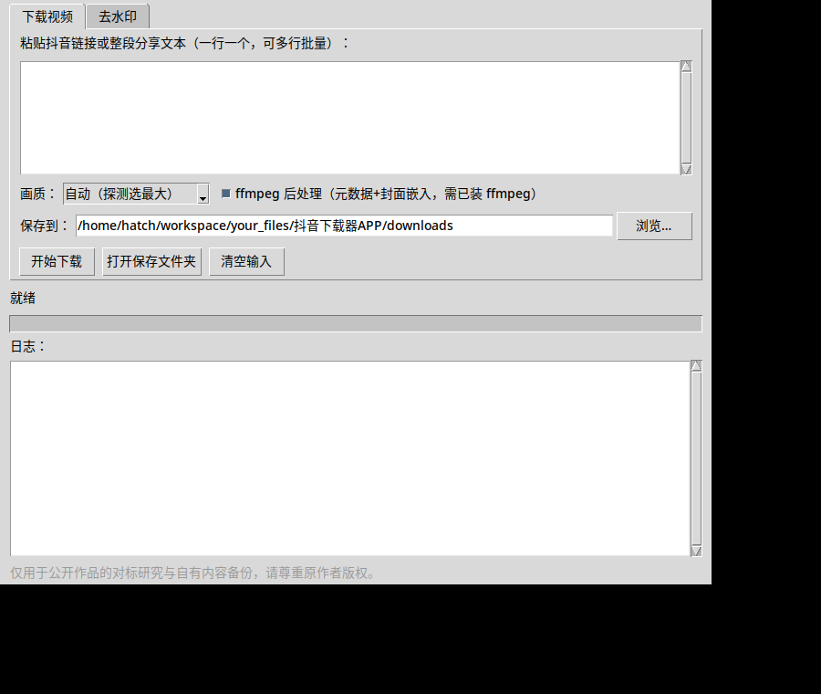
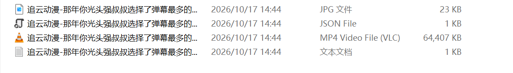
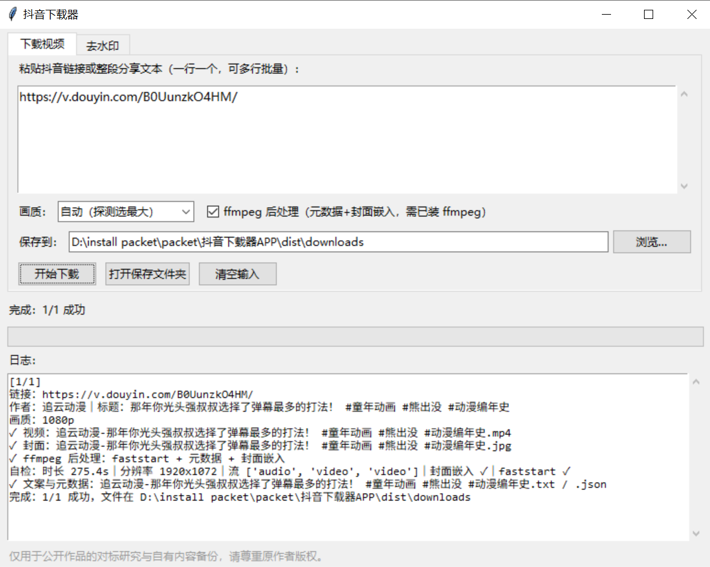

# 抖音下载器 · Douyin Downloader

<p>
  
</p>


粘贴抖音链接（或整段分享文本），批量下载**无水印**视频 + 封面 + 文案 + 数据元信息。零第三方依赖（纯 Python 标准库），自带画质探测、断点续传、ffmpeg 后处理，还内置一个给存量视频用的**去水印修复**功能。

为自媒体运营的对标研究和自有内容备份而做：看到好的作品，一键把素材和它的数据（点赞/评论/转发）一起存下来慢慢拆解。



## 功能亮点

- **批量解析**：链接、分享全文混着贴都能认；图集作品自动逐张下载图片
- **无水印高清**：多档画质探测后自动选最大的一档（可达 1080p），也可锁定 720p/1080p
- **断点续传**：`.part` 临时文件 + Range 续传 + 失败自动重试，大文件不怕断网
- **ffmpeg 后处理**（可选）：faststart 重封装、写入标题/作者/日期/文案元数据、嵌入封面，下载完 ffprobe 自检
- **完整产物**：每条作品产出 `.mp4 + .jpg（封面）+ .txt（文案）+ .json（点赞/评论/转发/发布时间/音乐）`
- **去水印修复**：给已经带烧录水印的本地视频（App 内保存、录屏来的）做 delogo 区域修复，附处理前后对照图

下载产物一览（视频 + 封面 + 文案 + 元数据四件套）：



## 三种形态，任选其一

| 形态 | 目录 | 适合谁 |
|---|---|---|
| 命令行版 | 根目录 `douyin-dl.py` | 想要单文件、双击或终端批量跑的人 |
| 桌面版 | [`desktop/`](desktop/) | 想要图形界面的人；可打包成免安装 exe |
| Web 版 | [`web/`](web/) | 想部署到自己服务器、手机电脑都能开的人（支持 PWA 加主屏幕） |

三者共用同一套久经实测的解析引擎，平台改版时只需更新引擎文件。

## 快速开始

### 命令行版

```bash
python douyin-dl.py "https://v.douyin.com/xxxxxx/"
python douyin-dl.py            # 交互模式：一行一个链接，空行开始
```

Windows 也可双击 `双击运行.bat`。产物落在脚本旁的 `downloads/` 文件夹。

### 桌面版（Windows）

1. 双击 `desktop/打包成EXE.bat`（首次需 Python，打包约 1–2 分钟）
2. 得到 `desktop/dist/抖音下载器.exe` —— 单文件免安装，拷到任何 Windows 电脑双击即用

不想打包：双击 `desktop/启动下载器.bat` 直接开界面。macOS / Linux 用 `desktop/build-mac-linux.sh`。详见 [desktop/README.md](desktop/README.md)。

桌面版在 Windows 上的实机运行：



### Web 版

```bash
cd web && python server.py        # 默认端口 8901，可用 PORT 环境变量改
```

浏览器打开即可用；可选访问口令（`DOUYIN_DL_CODE` 环境变量）。已做 PWA 适配，部署后手机浏览器「添加到主屏幕」就是一个 APP 图标。systemd 示例见 `web/douyin-dl.service`，详见 [web/README.md](web/README.md)。

> ffmpeg 为可选依赖：装上（或把 ffmpeg.exe 放到程序旁边）后处理与去水印自动生效；没有也能正常下载。

## 去水印

```bash
python douyin-dl.py --remove-watermark <视频文件> [--region auto|tl|br|x,y,w,h]
```

下载器抓的本身是无水印源，这个模式是给**已经带烧录水印**的存量视频用的：用 ffmpeg 的 delogo 对水印区域做邻域插值修复，默认同时处理左上/右下两角，并生成一张处理前/后抽帧对照图。


边界说清：这是“修复”不是“还原”——背景简单时近乎无痕；**水印压着字幕或人脸时，那部分内容会被一起涂抹**，这类素材更建议回原链接重抓无水印源。

## 工作原理

1. 展开 `v.douyin.com` 短链，取出作品 ID
2. 先访问 iesdouyin 首页**预热 cookie**（`ttwid`）——跳过这一步，分享页只会返回空壳，这是关键
3. 读分享页 SSR 数据（`window._ROUTER_DATA`）拿到 `play_addr`、文案、作者、统计、音乐、封面
4. 播放地址 `playwm` → `play` 即无水印源；改写 `ratio` 参数取高清档；探测各档体积择优
5. 从 CDN 流式下载（断点续传），可选 ffmpeg 后处理

> 对照实测：yt-dlp 当前版本对抖音走的网页详情接口路线在同一环境下返回 403（提示需要新鲜 cookie），本项目的分享页 SSR 路线则可直接工作；借鉴自 yt-dlp 的是它的工程做法——格式选择、断点续传、ffmpeg 元数据/封面后处理。

## 目录结构

```
.
├── douyin-dl.py          # 命令行版（单文件，含去水印模式）
├── 双击运行.bat           # Windows 双击启动命令行版
├── desktop/              # 桌面版（tkinter 界面 + 打包脚本）
├── web/                  # Web 版（零依赖 HTTP 服务 + PWA）
└── assets/               # README 配图
```

## 常见问题

- **解析失败/被风控？** 先稍后重试；同一 IP 高频请求容易触发限制。持续失败的链接多为作品已删除、私密或需要登录态。
- **没有 1080p 档？** 取决于原作品上传的最高画质，工具会选现有档里最大的一档。
- **要不要装 ffmpeg？** 不装也能下载；装了多出元数据/封面嵌入与去水印功能。
- **平台改版失效了怎么办？** 解析逻辑集中在引擎的 `fetch_item / pick_rendition` 两处，按新的分享页结构调整即可，界面层不用动。

## 免责声明

本项目仅供学习研究与个人素材管理使用。下载的作品版权归原作者所有，请勿搬运、冒充原创或用于商业侵权用途；使用者自行承担相应责任。

## License

[MIT](LICENSE)
